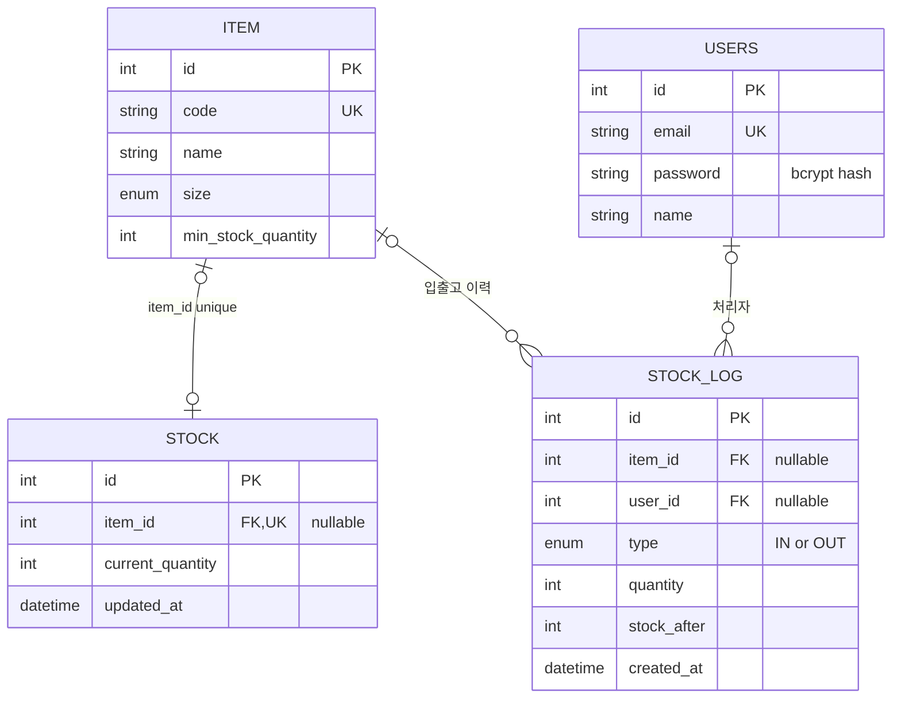

# StockFlow

물류 현장의 재고 불일치 경험을 바탕으로 만든 **매트리스 재고 관리 백엔드**입니다.
창고의 수기 기록과 사무실 장부가 달라 출고 당일 재고 부족을 확인했던 문제에서 출발했습니다.
품목별 현재 재고를 관리하고, 입출고 수량·처리자·변경 후 재고를 이력으로 남깁니다.

현재 범위는 단일 창고와 매트리스 사이즈 DS/SS/LQ/K/LK입니다.
핵심 재고 로직과 HTTP 흐름을 로컬 MySQL에서 검증했으며, 실제 운영·클라우드 배포는 수행하지 않았습니다.

## 주요 기능

| 영역      | 구현 내용                                                        |
| --------- | ---------------------------------------------------------------- |
| 인증      | 회원가입, bcrypt 비밀번호 해싱, 로그인과 JWT 발급                |
| 품목      | 고유 코드·모델명·사이즈·최소 재고 기준 CRUD                      |
| 재고      | 품목 생성 시 초기 수량 0, 전체·품목별 재고 조회                  |
| 입출고    | 양의 정수 수량 검증, 재고 부족 출고 거부, 재고·이력 트랜잭션     |
| 이력      | 처리자·품목·IN/OUT·수량·변경 후 재고, 품목·한국 날짜 기준 검색   |
| 부족 알림 | 출고 후 현재 수량이 최소 재고 기준 이하이면 lowStockWarning 반환 |

품목·재고 API는 JWT 인증이 필요합니다. 현재 인증 사용자 사이의 관리자·작업자 권한 구분은 없습니다.

## 기술과 구조

| 기술                                | 사용 이유                                                         |
| ----------------------------------- | ----------------------------------------------------------------- |
| NestJS / TypeScript                 | 도메인 모듈과 Controller·Service·DTO로 요청 처리와 업무 로직 분리 |
| MySQL / InnoDB                      | 관계·고유 제약, 트랜잭션과 행 잠금으로 재고 변경 관리             |
| TypeORM                             | 엔티티·관계 매핑, 트랜잭션 manager와 pessimistic_write 사용       |
| JWT / bcrypt                        | 요청 인증과 비밀번호 해싱·비교                                    |
| class-validator / class-transformer | 입력 검증과 응답 비밀번호 필드 제외                               |
| Jest / Supertest / Docker Compose   | DB 없는 단위 검사, 별도 MySQL 통합·HTTP 검사                      |

검증 환경은 Node.js 22.13.1, npm 10.9.2, MySQL 8.0.45입니다.
잠금 파일 기준 NestJS core 11.1.28, TypeScript 5.9.3, TypeORM 1.1.0, mysql2 3.23.2를 사용했습니다.
의존성 선언 범위는 [package.json](package.json), 설치 버전은 [package-lock.json](package-lock.json)을 기준으로 합니다.

```text
src/
  main.ts          전역 입력 검증·응답 직렬화·Swagger
  app.module.ts    환경 검증·DB 연결·모듈 조립
  auth/            가입·로그인·JWT 전략·Guard
  users/           사용자 엔티티와 조회·저장
  items/           품목 CRUD·초기 재고 생성
  stock/           재고 조회·입출고·이력 검색
test/
  support/         DB 대상 검사·테스트 데이터 생성과 정리
  integration/     실제 MySQL 동시 출고·롤백 검증
  http/            실제 AppModule의 HTTP 흐름 검증
```

보호된 요청은 인증 Guard → DTO 검증 → Controller → Service → TypeORM/DB를 거칩니다.
인증은 Guard, 응답 비밀번호 필드 제외는 전역 ClassSerializerInterceptor와 User의 Exclude로 처리합니다.

### 데이터 관계



업무 흐름상 품목 생성과 초기 재고 생성은 같은 트랜잭션으로 처리합니다.
현재 Stock.item과 StockLog.user도 nullable: false를 명시하지 않아 DB 매핑상 NULL을 허용합니다.
ERD는 이 매핑을 나타내며, 관계를 필수로 만드는 DB 제약 보강은 후속 과제입니다.
품목 삭제 시 재고는 CASCADE로 삭제되고, 이력은 남지만 품목 참조는 SET NULL이 됩니다.
물리 매핑의 근거는 [Item](src/items/entity/item.entity.ts), [Stock](src/stock/entity/stock.entity.ts),
[StockLog](src/stock/entity/stock-log.entity.ts), [User](src/users/entity/user.entity.ts)입니다.

## 재고 정합성을 위한 선택

### 동시 출고: 잠금 획득 후 부족 검사

같은 재고를 여러 요청이 동시에 읽으면 각각 출고 가능하다고 판단할 수 있습니다.
출고에서는 트랜잭션 안에서 pessimistic_write로 재고를 조회한 뒤 부족 여부를 검사하고 차감합니다.
이후 OUT 이력까지 저장하고 커밋합니다. 입고는 원자적 increment 후 재조회와 IN 이력 저장을 같은 트랜잭션에서 수행합니다.

초기 재고 10개에 1개 출고 요청 20개를 겹쳐 실행한 검증에서 성공 10건·부족 실패 10건,
최종 재고 0개·OUT 이력 10건을 확인했습니다.
이는 해당 MySQL 환경의 시나리오 검증이며 처리량 측정이나 모든 경쟁 상황의 보장은 아닙니다.

### 재고와 이력: 함께 성공하거나 함께 취소

재고만 바뀌고 이력 저장이 실패하면 현재 수량과 변경 기록이 어긋납니다.
입출고는 같은 transaction manager로 재고와 이력을 저장합니다.
실제 이력 INSERT에 외래 키 오류를 유도한 입고·출고 테스트에서 수량 변경도 롤백되는 것을 확인했습니다.
품목·초기 재고도 같은 트랜잭션으로 생성하지만, 그 생성 실패의 롤백 시나리오는 아직 별도로 검증하지 않았습니다.

### 날짜 검색: 한국 시간의 시작 이상·다음 날 미만

YYYY-MM-DD 형식과 실제 달력 날짜를 검증하고, 시작일이 종료일보다 늦으면 400을 반환합니다.
검색은 한국 시간 시작일 자정 이상·종료일 다음 날 자정 미만의 반개방 범위를 사용합니다.
예를 들어 2026-10-20 하루는 UTC 기준 다음 범위입니다.

```text
2026-10-19T15:00:00Z <= createdAt < 2026-10-20T15:00:00Z
```

다음 날 자정을 제외하므로 종료일의 소수 초 정밀도에 맞춰 마지막 시각을 만들어 넣을 필요가 없습니다.
실제 DB·HTTP에서 시작 직전, 시작 정각, 종료일 마지막 초, 다음 날 정각의 포함·제외를 확인했습니다.

구현: [StockService](src/stock/service/stock.service.ts), [ItemService](src/items/service/Items.service.ts),
[날짜 DTO](src/stock/dto/get-stock-logs.dto.ts).
검증: [재고 통합 테스트](test/integration/stock.integration-spec.ts), [HTTP 테스트](test/http/core-flow.http-spec.ts).

## 설치와 로컬 앱 실행

PowerShell에서 저장소 루트 기준으로 실행합니다. Node.js 22.13.1 기준의 명령이며 Docker Compose는 DB 테스트에 사용합니다.

```powershell
npm ci
npm run test:unit -- --runInBand
```

앱 실행 전 MySQL 8.0에 **새 로컬 개발 DB와 전용 계정**을 준비합니다.
[.env.example](.env.example)의 stockflow_local·3306은 예시이며 실제 준비한 개발 DB 설정으로 바꿉니다.
앱용 설정과 3308 테스트용 설정은 분리합니다.

```powershell
if (Test-Path -LiteralPath .env) { throw '기존 .env를 보존하고 설정을 직접 확인하세요.' }
Copy-Item -LiteralPath .env.example -Destination .env
```

복사한 파일의 DB_PASSWORD와 JWT_SECRET을 직접 설정합니다. 비밀번호·키 기본값은 제공하지 않습니다.

| 변수                                    | 의미                                |
| --------------------------------------- | ----------------------------------- |
| NODE_ENV                                | development 또는 production만 허용  |
| PORT                                    | HTTP 포트, 예시 3000                |
| DB_HOST / DB_PORT                       | 개발 MySQL 주소와 포트              |
| DB_DATABASE / DB_USERNAME / DB_PASSWORD | 준비한 개발 DB와 전용 계정          |
| JWT_SECRET                              | 로컬에서 생성한 별도 무작위 서명 키 |
| JWT_EXPIRES_IN                          | 토큰 수명, 숫자로 된 초 단위 값     |

development에서는 TypeORM synchronize가 켜져 스키마를 자동 생성·변경합니다.
새 개발 DB만 지정하고 기존 데이터가 있는 공유 DB에는 적용하지 않습니다.
production에서는 자동 변경이 꺼지며, 운영용 migration 절차는 아직 마련하지 않았습니다.
서버의 날짜 함수도 같은 기준을 쓰도록 개발 MySQL의 서버·세션 시간대를 +00:00으로 맞춥니다.

```powershell
npm run start:dev
```

기본 API 주소는 http://localhost:3000 이며 코드에 정의된 Swagger 경로는 http://localhost:3000/api 입니다.
컴파일 후 실행 명령은 npm run build → npm run start:prod입니다.
현재 검증 결과는 실제 AppModule을 사용한 HTTP 테스트까지이며,
main.ts 자체·컴파일 산출물의 독립 기동과 Swagger 화면은 아직 실행 확인하지 않았습니다.

## API 사용

가입·로그인 외 아래 품목·재고 API에는 `Authorization: Bearer <accessToken>` 헤더가 필요합니다.
전체 앱의 /api는 Swagger 경로이며, 아래 업무 API 앞에 /api 접두어를 붙이지 않습니다.

| 메서드               | 경로           | 내용                                         |
| -------------------- | -------------- | -------------------------------------------- |
| POST                 | /auth/signup   | 가입, 성공 201·중복 이메일 409               |
| POST                 | /auth/login    | 로그인, 현재 구현의 성공 상태는 201·실패 401 |
| POST / GET           | /items         | 품목 생성 / 목록                             |
| GET / PATCH / DELETE | /items/:itemId | 품목 조회 / 수정 / 삭제                      |
| GET                  | /stock         | 재고 목록                                    |
| GET                  | /stock/:itemId | 품목 재고 조회                               |
| POST                 | /stock/in      | 입고                                         |
| POST                 | /stock/out     | 출고                                         |
| GET                  | /stock/logs    | 품목·날짜별 이력 조회                        |

다음 본문은 API 클라이언트에서 차례대로 사용할 예시입니다. 비밀번호는 예시용이고 실제 계정 값을 포함하지 않습니다.

1. POST /auth/signup

   ```json
   {
     "email": "learner@example.com",
     "password": "example-only-password",
     "name": "작업자"
   }
   ```

2. POST /auth/login

   ```json
   { "email": "learner@example.com", "password": "example-only-password" }
   ```

   응답의 accessToken을 이후 요청의 Bearer 토큰으로 사용합니다. 토큰은 문서·Git에 저장하지 않습니다.

3. POST /items

   ```json
   {
     "code": "SF-K-001",
     "name": "매트리스 A",
     "size": "K",
     "minStockQuantity": 2
   }
   ```

   응답 id가 이후 itemId입니다. 생성된 품목에는 수량 0의 재고가 함께 생성됩니다.

4. POST /stock/in → POST /stock/out

   생성 응답의 id가 1인 경우 각각 다음 본문을 사용합니다.

   ```json
   { "itemId": 1, "quantity": 10 }
   ```

   ```json
   { "itemId": 1, "quantity": 3 }
   ```

   최종 수량은 7입니다. 출고 응답에는 currentQuantity와 lowStockWarning이 포함됩니다.
   quantity는 1 이상의 정수이며 "1" 같은 문자열은 허용하지 않습니다.

5. GET /stock/logs?itemId=1&startDate=2026-10-20&endDate=2026-10-20

   예시 날짜를 실제 처리일로 바꿔 조회합니다.
   날짜 생략·한쪽 날짜·동일한 시작/종료일을 허용하고 createdAt 내림차순으로 반환합니다.
   잘못된 날짜·역전 범위·잘못된 수량은 400, 미인증은 401, 없는 품목은 404,
   중복 품목 코드는 409입니다. 재고 부족도 400이며 실패한 출고는 재고와 이력을 변경하지 않습니다.

## 테스트 재현

### DB 없는 단위 테스트

```powershell
npm run test:unit -- --runInBand
```

기본 npm test도 같은 단위 테스트를 선택합니다. DB 통합·HTTP 테스트와 기존 TRUNCATE 초안은 제외합니다.
기존 npm run test:e2e는 전용 DB 안전 구성을 적용하지 않은 별도 설정이므로 아래 절차의 대체 명령으로 사용하지 않습니다.

### 전용 MySQL 준비

Docker 엔진을 실행하고 호스트 3308이 다른 서비스에 사용되지 않는지 확인합니다.
HTTP 테스트는 루트 .env가 있는 작업 폴더에서는 중단됩니다.
앱 설정이 있는 기존 폴더를 변경·삭제하지 말고, .env가 없는 별도 작업 사본에서 이 절차를 사용합니다.
단위 테스트에는 이 제약이 없습니다.

```powershell
if (Test-Path -LiteralPath .env.test.local) { throw '기존 테스트 환경 파일을 보존하고 직접 확인하세요.' }
Copy-Item -LiteralPath .env.test.local.example -Destination .env.test.local
```

파일에서 TEST_DB_PASSWORD와 TEST_DB_ROOT_PASSWORD를 서로 다른 로컬 테스트용 비밀번호로 설정합니다.
통합 테스트 실행을 선택할 때만 RUN_DB_TESTS=1로 설정합니다.
NODE_ENV=test와 아래 대상 값은 유지합니다.

```text
TEST_DB_HOST=127.0.0.1
TEST_DB_PORT=3308
TEST_DB_DATABASE=stockflow_test
TEST_DB_USERNAME=stockflow_test
```

```powershell
docker compose --env-file .env.test.local -f compose.test.yml --profile integration up -d --wait --wait-timeout 120 mysql-test
```

[compose.test.yml](compose.test.yml)은 localhost의 3308만 공개하고 UTC·InnoDB를 사용하는 전용 MySQL을 실행합니다.
데이터 디렉터리는 tmpfs라 컨테이너 중지·제거 시 내용이 사라집니다.
mysql:8.0 태그를 사용하므로 새로 받는 이미지 버전은 기존 검증 버전과 달라질 수 있습니다.

### 재고 통합 테스트

Jest를 직접 실행할 때는 Node의 --env-file로 테스트 설정을 명시적으로 전달합니다.
npm run test:integration 자체는 환경 파일을 자동으로 읽지 않습니다.
기존 프로세스의 환경변수가 파일보다 우선하므로 NODE_ENV와 TEST_DB_* 충돌도 확인합니다.

```powershell
node --env-file=.env.test.local node_modules/jest/bin/jest.js --config test/jest-integration.json --runInBand
```

### HTTP 테스트

```powershell
New-Item -ItemType Directory -Path .tmp -Force | Out-Null
$reportDir = '.tmp/http-' + [Guid]::NewGuid().ToString('N')
npm run test:http -- --env-file .env.test.local --allow-db-tests --report-dir $reportDir
```

HTTP runner는 실행 플래그를 받아 테스트 실행을 명시적으로 활성화하고, 상속된 DB/JWT 설정을 제거합니다.
허용된 TEST_DB_*를 앱 DB_*로 옮기며 임시 JWT 키를 생성합니다.
AppModule에는 NODE_ENV=production을 사용해 자동 스키마 변경을 끄지만, 대상은 위 테스트 DB입니다.
보고서 폴더는 새 경로여야 하며 jest-results.json과 database-report.json이 생성됩니다.

두 DB 테스트 모두 연결 전 정확한 호스트·포트·DB·계정을 검사하고, 연결 후 실제 DB·계정·UTC 세션을 확인합니다.
테이블이 하나도 없는 테스트 스키마만 생성하며, 기존 테이블은 이름·InnoDB 검사 후 사용하고 자동 교정하지 않습니다.
각 테스트에서 만든 데이터만 식별해 정리하고 전체 TRUNCATE나 외래 키 검사 비활성화를 사용하지 않습니다.
같은 테스트 DB를 공유하는 테스트 실행은 서로 겹치지 않게 진행합니다.

## 검증 결과

아래는 저장된 로컬 실행 결과입니다. README 작성 단계에서는 DB 테스트를 다시 실행하지 않았습니다.

| 구분       | 실행일     | 결과                | 확인 범위                                                                       |
| ---------- | ---------- | ------------------- | ------------------------------------------------------------------------------- |
| 단위       | 2026-10-20 | 118개 통과, 6 suite | 날짜 DTO·서비스, DB 대상·정리·HTTP 환경 안전장치, 기본 앱 서비스                |
| MySQL 통합 | 2026-10-19 | 4개 통과            | 동시 출고, 재고 부족, 입고·출고 이력 저장 실패 롤백                             |
| HTTP       | 2026-10-20 | 24개 통과           | 가입·로그인·JWT 거부, 품목 CRUD, 입출고·오류, 비밀번호 필드 제외, KST 날짜 검색 |

MySQL 8.0.45·InnoDB·REPEATABLE-READ·+00:00 환경에서 검증했습니다.
동시 출고 테스트는 서로 다른 두 QueryRunner의 실제 트랜잭션 시작을 확인한 뒤 진행합니다.
실패 시 롤백 검증은 이력 저장을 mock으로 바꾸지 않고 실제 외래 키 오류를 사용합니다.
HTTP 테스트는 실제 AppModule과 localhost 임시 서버를 사용하며 main.ts와 같은 전역 입력 검증·직렬화를 적용합니다.
검증 종료 후 네 테이블의 데이터가 모두 0건인 것과 HTTP 리스너 종료를 확인했습니다.

코드와 재현 절차는 이 저장소에 포함하고, 실제 비밀번호·JWT·개인 로컬 경로·로컬 실행 보고서는 공개 문서에 포함하지 않습니다.

## 현재 한계와 후속 개선

- 동시 입고·입출고 혼합 시나리오, 부하·성능, 배포와 복구는 미검증입니다. HTTP 테스트는 main.ts bootstrap·Swagger를 실행하지 않습니다.
- 가입은 공개이며 역할별 권한 구분이 없습니다. 운영 서비스로 공개하기 전 접근 정책을 정해야 합니다.
- 품목 수정·삭제 시 이력에 당시 품목 정보 스냅샷이 없어 과거 품목 정보를 완전히 복원할 수 없습니다.
- 요청 재전송에 대한 멱등성, 페이지네이션, 재고 수량·관계의 DB 제약, 데드락·잠금 시간 초과 처리는 후속 과제입니다.
- 운영용 migration과 배포 절차가 없습니다. 개발 모드의 자동 스키마 변경을 운영 스키마 관리로 사용하지 않습니다.
